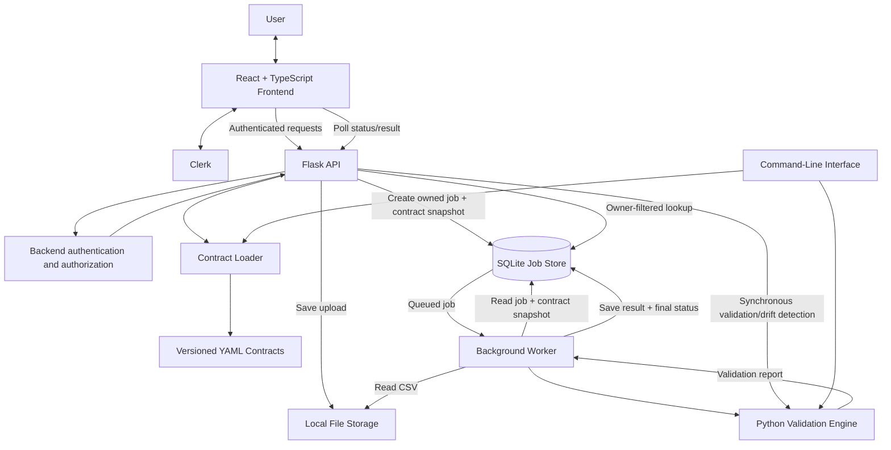

# Sentinel — System Design

## 1. Purpose and Scope

### 1.1 Problem

Business processes often exchange CSV files. Unexpected columns, missing required fields, invalid values, or business-rule violations can break downstream processing or produce unreliable results.

Sentinel validates CSV files against explicitly selected, versioned YAML contracts. A contract defines the expected structure, field types, required values, and supported rules. Sentinel reports detected violations and whether the data is `READY` or `NOT_READY` for downstream use. The contract is the source of truth: incoming files do not automatically change it, and Sentinel does not automatically correct customer data.

The current implementation supports authenticated CSV uploads, contract discovery, synchronous validation, schema-drift reporting, asynchronous jobs, and a command-line entry point. The broader product direction is **Automated Data Quality & Integration Monitoring**, potentially adding scheduled ingestion and external-system connectors.

### 1.2 Requirements

**Current functional capabilities**

- Discover available contracts and versions.
- Validate a CSV against an explicitly selected contract version.
- Report record counts, validation status, and issues.
- Identify missing and unexpected columns as schema-drift findings.
- Submit asynchronous jobs and retrieve their status and results.
- Authenticate users and restrict job retrieval to the job's owner.

**Constraints and quality goals**

- Contract definitions remain authoritative and versioned.
- Validation logic is reusable outside the HTTP API.
- The backend enforces authentication and job ownership.
- The current request-size limit is 10 MiB.
- Production throughput and capacity have not been established through load testing.

**Out of scope today**

Scheduled ingestion, external-system connectors, downstream delivery, user-facing contract authoring, organisation/team access, automatic data correction, and formal production capacity guarantees.

## 2. Architecture

### 2.1 Components

| Component | Responsibility |
|---|---|
| React + TypeScript frontend | Sign-in flow, contract/version selection, CSV submission, job polling, and report display. |
| Clerk | User identity and authentication. |
| Flask API | Authenticates requests, exposes endpoints, creates jobs, and returns status and results. |
| Versioned YAML contracts | Define expected CSV structure and business rules. |
| Contract loader | Loads the selected contract definition. |
| Python validation engine | Applies contract rules and produces a structured report. |
| Background worker | Claims queued jobs, reads their files and saved contract snapshots, invokes the engine, and persists outcomes. |
| SQLite | Stores job metadata, contract snapshots, status, result, errors, and timestamps. |
| Local filesystem | Stores uploaded CSV files and contract files. |
| CLI | Uses the shared contract-loading and validation logic without the web interface. |

### 2.2 Architecture Diagram

### 2.3 Architectural Boundaries

The API handles requests and access control; the worker manages asynchronous job processing; the validation engine applies the rules; and the storage layer retains files and job state. The shared engine prevents API, CLI, and worker entry points from needing separate implementations of the validation rules.

## 3. Core Workflows

### 3.1 Submit and Validate a Job

1. The user signs in, selects a contract and version, and uploads a CSV.
2. The API verifies the user's identity, saves the upload, and creates a SQLite job record containing the owner, input path, selected contract snapshot, and initial status `QUEUED`.
3. The API returns `202 Accepted` and a job identifier; validation does not need to finish within the submission request.
4. The worker claims the job and changes its status to `RUNNING`.
5. The worker reads the CSV and saved contract snapshot, invokes the validation engine, and saves the report and final processing status.
6. The frontend polls the job endpoint and displays progress or the completed report.

The frontend currently polls approximately every 1.5 seconds while a job is `QUEUED` or `RUNNING`.

### 3.2 Job Status vs. Validation Status

These fields describe different outcomes:

| Job status | Validation status | Meaning |
|---|---|---|
| `QUEUED` | Not available yet | Waiting for a worker. |
| `RUNNING` | Not available yet | Being processed. |
| `COMPLETED` | `READY` | Validation completed; no blocking violations were found. |
| `COMPLETED` | `NOT_READY` | Validation completed; the report contains violations. |
| `FAILED` | May be unavailable | Processing could not complete successfully. |

A `NOT_READY` result is not a processing failure. Sentinel reports violations for the data owner to investigate rather than automatically changing the data.

### 3.3 Other Validation Entry Points

- `POST /validate` performs validation synchronously within the API request.
- `POST /detect-drift` returns missing-column and unexpected-column findings alongside data-quality information.
- The CLI loads an explicitly selected contract and calls the same validation engine.

Unlike asynchronous jobs, synchronous requests do not return a job identifier for later polling.

### 3.4 Authentication and Authorization

Clerk supplies the user identity, which the backend verifies. Job creation records that identity as `owner_id`; job retrieval filters by both job ID and owner. Requests for a nonexistent job and a job owned by another user return `404 Not Found`. The frontend is not the security boundary: authorization is enforced by the API.

The current model supports individual-user ownership, not shared organisation or team access.

## 4. Data Model and API

### 4.1 Validation Job

SQLite stores the primary record for each asynchronous job.

| Field | Purpose |
|---|---|
| `job_id` | Job identifier. |
| `owner_id` | Authenticated submitting user. |
| `dataset_name` | Dataset associated with the job. |
| `status` | `QUEUED`, `RUNNING`, `COMPLETED`, or `FAILED`. |
| `input_path` | Location of the uploaded CSV on local storage. |
| `contract_json` | Snapshot of the selected contract definition. |
| `result_json` | Persisted validation report, when available. |
| `error` | Processing error information, when applicable. |
| `created_at`, `started_at`, `finished_at` | Job lifecycle timestamps. |

The CSV itself and YAML contracts remain files on disk; the job record stores the input path and contract snapshot. File storage and SQLite are separate systems, so the upload and job creation are not one atomic transaction.

### 4.2 Validation Report

The report contains a status (`READY` or `NOT_READY`), total/valid/invalid record counts, and an issue list. Each issue can identify the affected row and field where applicable, a machine-readable code, and a message. Reports describe conformance to the selected contract; they do not prove factual correctness beyond the rules and reference data available to Sentinel.

### 4.3 API Endpoints

All listed endpoints are protected by backend authentication.

| Method and endpoint | Purpose |
|---|---|
| `GET /contracts` | Returns available contract names, display names, and versions. |
| `POST /validate` | Validates a CSV synchronously. |
| `POST /detect-drift` | Returns `has_drift`, missing/unexpected-column `findings`, and `data_quality`. |
| `POST /jobs` | Accepts multipart fields `file`, `contract_name`, and `contract_version`; creates an asynchronous job and returns `202 Accepted`. |
| `GET /jobs/<job_id>` | Returns owner-authorized job status and available result/error information. |
| `GET /me` | Returns the identity recognised by the backend. |

Contract files are supplied through the configured contract directory; users cannot create or manage contract definitions through the current UI. Exact request and response schemas should be maintained alongside the API code if these contracts evolve.

## 5. Design Decisions and Trade-offs

| Decision | Reason | Trade-off or limitation |
|---|---|---|
| **Queue and background worker** | Keeps longer-running validation outside the submission request and provides a path to automated ingestion and concurrent processing. | More lifecycle and failure-handling complexity. A worker crash can leave a job stuck in `RUNNING`; automatic recovery is not implemented. A worker architecture alone does not guarantee concurrency or throughput. |
| **Reusable validation engine** | Keeps rules in one place for API, worker, and CLI callers, avoiding duplicated and potentially inconsistent validation. | Callers must share a clear engine interface and avoid reimplementing rules at their entry points. |
| **Versioned YAML contracts** | Readable, explicit, reviewable definitions make the expected data authoritative and support changing business rules over time. | Contract syntax and structure must be validated, and business rules still require review. Contract authoring is file-based rather than available in the UI. |
| **Contract snapshot per job** | Preserves the selected definition at submission so later contract changes do not silently alter queued work. | Adds some storage and preserves a snapshot that must be written and read correctly. It does not make file and database writes atomic. |
| **SQLite + local files** | Simple to configure and sufficient for the initial implementation without separate database or file-storage infrastructure. | Database contention, local-file availability, backups, retention, and multi-instance deployments need further design as workload grows. |
| **Clerk + owner checks** | Uses a managed identity provider while Sentinel enforces access to its own resources. | Adds a third-party dependency and potential provider, pricing, and migration considerations. Current ownership is user-level only. |
| **Contract-driven drift reporting; no auto-correction** | Detects deviations from the expected schema without allowing incoming data to redefine it or inventing corrections. | Data owners must investigate issues and maintain contracts when requirements genuinely change. Current drift findings focus on missing and unexpected columns. |
| **Separate job and validation statuses** | Distinguishes successful processing from whether the data satisfies the contract. | API consumers and UI must interpret both statuses correctly. |

## 6. Reliability and Operational Limitations

### 6.1 Known Failure Behaviour

| Scenario | Current behaviour / limitation |
|---|---|
| CSV violates its contract | Validation returns `NOT_READY`; the job can still be `COMPLETED`. |
| Contract is invalid or unusable | Contract loading must fail rather than treating it as a usable definition; actionable error reporting is important. |
| Input file is missing or unreadable | Processing may fail because the worker depends on the recorded local path. |
| Worker stops after claiming a job | The job may remain `RUNNING`; automatic abandoned-job recovery is not implemented. |
| File save succeeds but job creation fails, or vice versa | Filesystem and SQLite operations are separate; partial state and orphaned uploads are possible. |
| SQLite or local storage is unavailable | Job submission, processing, or result persistence may be interrupted. |
| User requests another user's job | Backend ownership filter denies access using `404 Not Found`. |

### 6.2 Reliability Gaps

Persistent records allow clients to retrieve a job after the original HTTP request ends, but persistence alone does not guarantee recovery. Before production use, Sentinel needs explicit policies and tests for abandoned jobs, retries, partial submissions, missing files, useful error reporting, database backups, file retention, and storage cleanup.

A recovery mechanism would need to identify stale `RUNNING` jobs without interrupting genuinely long-running work, and define when a job can be retried or marked `FAILED`. These are proposed improvements, not current guarantees.

### 6.3 Capacity and Availability

The current request-size limit is 10 MiB. Synchronous validation duration depends on file size, validation complexity, and available resources. Maximum throughput, concurrent job capacity, and production availability have not been established through load testing; no numerical capacity guarantee should be inferred.

The local database and filesystem are suitable for the current implementation but have not been demonstrated as a distributed, multi-instance production storage design. The system should not be described as providing guaranteed recovery or availability.

## 7. Capacity, Scalability, and Future Evolution

### 7.1 Capacity Factors

Capacity planning should be based on measured and expected values for:

- Jobs submitted per hour/day and number of active users.
- Typical and maximum CSV sizes and validation duration.
- Validation-rule complexity and required worker concurrency.
- Queue wait time and acceptable processing latency.
- File/result retention periods and available storage.
- Frequency of future scheduled ingestion and reliability of external systems.

If jobs arrive faster than workers can finish them, the backlog grows. Adding workers may help only if job claiming is safe and the database, storage, CPU, and memory can support the additional work.

### 7.2 Possible Evolution

| Area | Potential future change | Reason to consider it |
|---|---|---|
| Worker processing | Multiple coordinated workers, job leases or stale-job recovery, monitoring | Higher volume, concurrent execution, or need for recovery. |
| Queueing | Improve the current database-backed queue or introduce a message broker | Measured contention, distribution, or operational needs justify the extra dependency. |
| Job database | Consider PostgreSQL or another shared relational database | Concurrent access, deployment, recovery, or availability requirements exceed the current arrangement. |
| File storage | Move from local files to shared/object storage | API and workers run on different instances or durable shared storage is required. |
| Monitoring | Track queue depth, job age, failures, processing duration, disk use, and database health | Operators need to detect stuck work and capacity problems. |
| Resource controls | File-size limits, timeouts, and workload-specific worker policies | Large or expensive jobs threaten the responsiveness of other work. |

These are options, not committed infrastructure choices. They should follow measured bottlenecks and product requirements rather than being introduced pre-emptively.

### 7.3 Product Evolution

The intended longer-term direction is automated data-integration monitoring. A scheduler and selected external connectors could retrieve customer data and submit it to the existing validation pipeline. Persisted results could then support views of recent validation health, repeated data-quality issues, schema changes, and missing expected deliveries. Reconciliation could be added where suitable rules and reference data exist.

These capabilities are future scope. They would need explicit designs for source authentication, scheduling, external-system failures, integration-to-contract mapping, and increased job volume. The core principle remains unchanged: new ingestion paths should reuse the shared validation engine, and incoming data should not silently redefine the contract.

### 7.4 Evolution Plan

1. **Stabilise and measure:** Test representative CSV sizes, validation duration, queue growth, and failure scenarios; establish workload targets.
2. **Improve reliability:** Design stale-job recovery, retry policies, monitoring, backups, and file-retention/cleanup procedures.
3. **Add ingestion selectively:** Implement a scheduler and a small set of customer connectors against defined requirements.
4. **Scale when needed:** Add workers or change queue, database, and file storage based on measured limitations.

### 7.5 Open Questions

Capacity and product planning still need answers to these questions: expected jobs per day, representative file sizes, required concurrency and queue latency, file/report retention, recovery expectations, service availability targets, and the first external systems to support.

## 8. Summary

Sentinel validates CSV files against explicitly selected, versioned YAML contracts. A React/TypeScript frontend submits work through an authenticated Flask API. For asynchronous validation, the API stores the upload and creates an owned SQLite job containing a contract snapshot; a background worker runs the shared Python validation engine and persists the report. The frontend retrieves status and results through owner-filtered API endpoints. Synchronous validation, drift detection, and CLI validation reuse the same core engine.

The design prioritises explicit contracts, reusable validation logic, persistent job state, and backend-enforced ownership. A job's processing status is distinct from its validation outcome, and Sentinel reports problems rather than automatically correcting customer data.

The current implementation uses SQLite and local file storage, has a 10 MiB request-size limit, and has not been load-tested. Automatic recovery of jobs abandoned in `RUNNING`, scheduled ingestion, external connectors, and production-scale guarantees remain future work. The next steps are to measure real workload behaviour, address reliability gaps, and evolve the infrastructure only as requirements justify it.
